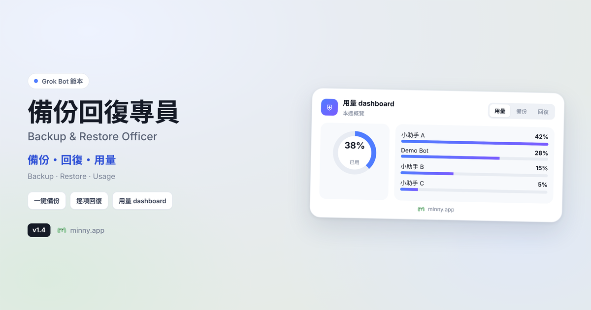
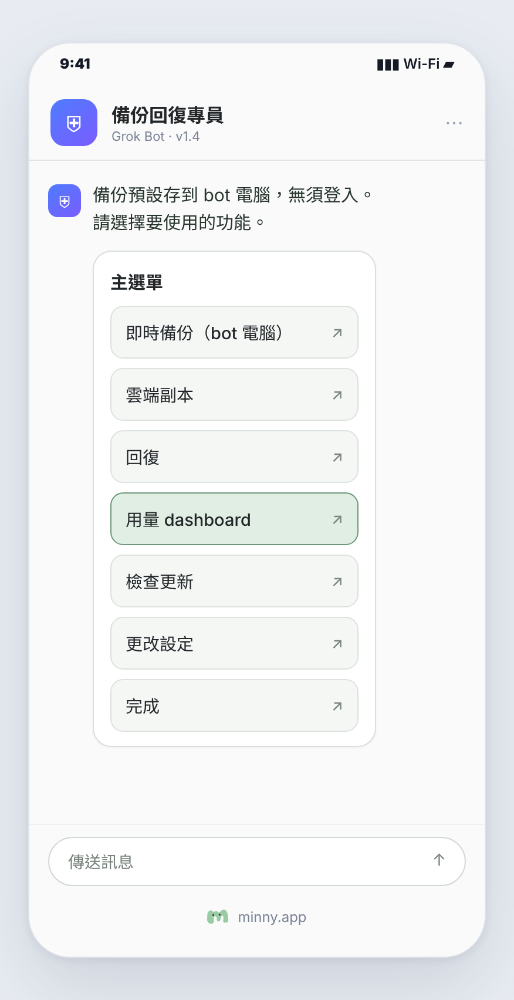
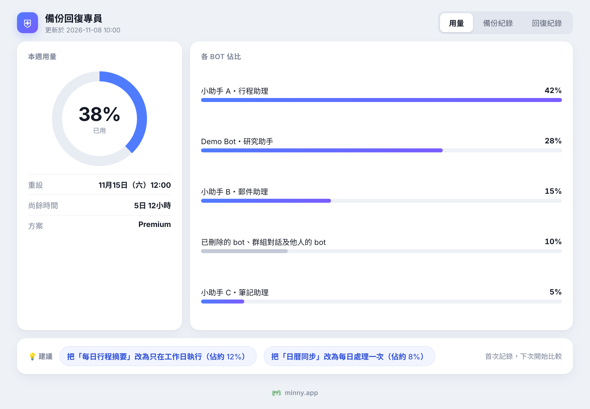
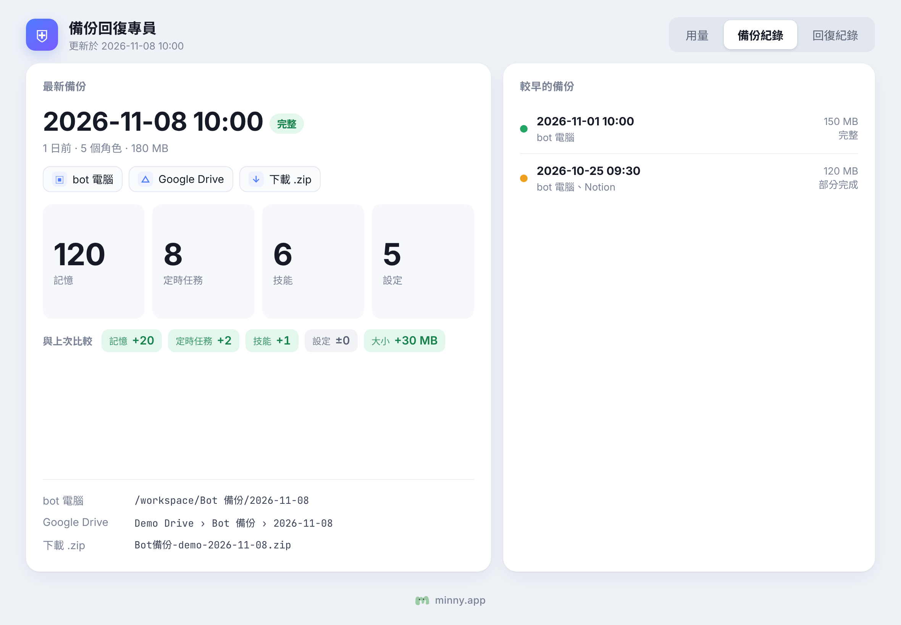
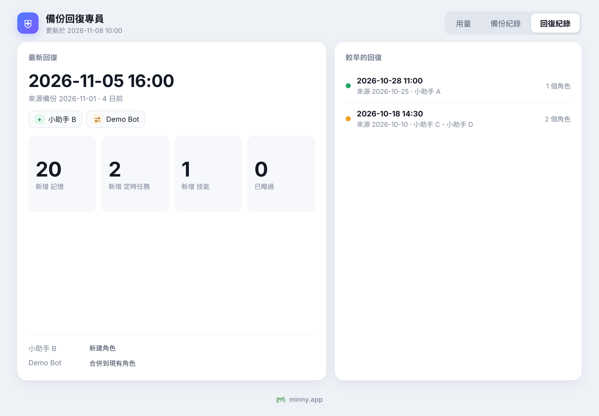
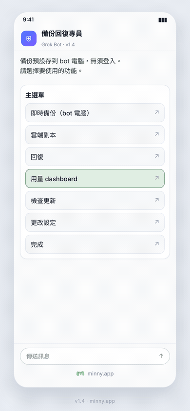

# 備份回復專員／Backup & Restore Officer

Grok Bot 範本：替整個 bot 團隊另存檔案、記憶、定時任務、技能及設定，並提供用量 dashboard。

範本連結：https://x.ai/bot/RLamfuRtaAysHTdnmuYIV

<!-- 品牌資料卡：由 Claude 填寫 -->



## 功能

- **一鍵備份**：記憶、定時任務、技能、設定一併另存；工作檔案整批複製，不逐份閱讀。預設存於 bot 電腦的 `Bot 備份/`，無須登入；可選雲端副本（Google Drive／Notion）。
- **回復**：比對備份與現有角色，逐項確認；只合併缺少的內容，不覆蓋、不刪除現有資料。
- **用量 dashboard**：三個分頁（用量／備份紀錄／回復紀錄）；建議最多 2 條，每條佔比約 ≥ 5%。
- **備份提醒**：主選單上方顯示上次備份距今過久（預設 7 日）。
- **兩次備份比較**：新備份與上一份比對記憶、任務、技能、設定及容量差異。
- **舊備份清理建議**：超過容量或份數門檻時提出建議；**只在你確認後**才刪除 bot 電腦上的舊備份，並一律保留最新三份。

## 如何匯入

1. 打開範本連結：https://x.ai/bot/RLamfuRtaAysHTdnmuYIV  
2. 按指示加入你的 bot 團隊。  
3. 首次對話會問語言（中文／English），其後設定備份位置。

本倉庫的 `skills/` 與 `src/usage_dash.py` 對應範本內容，方便閱讀與再發佈；日常使用請直接匯入範本。

## 主選單

| 選項 | 說明 |
|---|---|
| 即時備份（bot 電腦） | 立刻另存一份 |
| 雲端副本 | 把最新備份複製到 Drive 或 Notion |
| 回復 | 從備份回復角色 |
| 用量 dashboard | 查看用量、備份及回復紀錄 |
| 檢查更新 | 比對範本版本 |
| 更改設定 | 語言、畫面尺寸、提醒日數等 |
| 完成 | 結束今次操作 |



## 畫面預覽

畫面使用虛構示範數據，並非任何真實帳號。

| 用量 | 備份紀錄 | 回復紀錄 |
|---|---|---|
|  |  |  |



## 倉庫結構

```
skills/          四份技能（中／英備份回復、中／英開始使用）
src/usage_dash.py  用量／備份／回復 dashboard 程式
docs/images/     預覽圖與示意動畫
brand/           m.svg；BRAND.md／TRADEMARK.md 另行提供後放入
LICENSE          MIT
```

路徑寫成 bot 電腦上的 `Bot 備份/`（含 `用量/`、`紀錄/`）；匯入 Grok Bot 後按技能說明使用。

## 授權

程式碼採用 MIT 授權，見 [LICENSE](LICENSE)。版權行：`Copyright (c) 2026 Leonard Wong <Contact@minny.app>`。

**minny.app 名稱及 m 字標不屬開源授權範圍**，說明見 `brand/TRADEMARK.md`（由 Claude 另行提供後放入 `brand/`）。`brand/` 最終只應含 `m.svg`、`BRAND.md`、`TRADEMARK.md`；放入後請刪除 `brand/PLACEHOLDER.txt`。

---

## English

**Backup & Restore Officer** is a Grok Bot template that keeps a separate copy of every role’s files, memories, routines, skills and settings, and shows a usage dashboard.

Template: https://x.ai/bot/RLamfuRtaAysHTdnmuYIV

### Features

- **One-tap backup** — memories, routines, skills and settings; work files are bulk-copied without being read. Default store: `Bot 備份/` on the bot computer (no login). Optional cloud copy to Google Drive or Notion.
- **Restore** — compare the backup with current roles; confirm item by item; merge only what is missing (never overwrite or delete).
- **Usage dashboard** — tabs for Usage, Backups and Restores; at most two suggestions, each about ≥ 5% of usage.
- **Backup reminder** — a one-line notice above the menu when the last backup is older than N days (default 7).
- **Backup comparison** — each new backup is compared with the previous one.
- **Old-backup cleanup** — suggestions only; **deletes only after you confirm**, always keeping the latest three on the bot computer.

### Import

Open the template link above and add it to your team. The first chat asks for language, then backup settings.

### Licence

Code is MIT (see [LICENSE](LICENSE)). The **minny.app name and m mark are not covered** by that licence; see `brand/TRADEMARK.md` (supplied separately). The `brand/` folder should end up with only `m.svg`, `BRAND.md` and `TRADEMARK.md` — delete `brand/PLACEHOLDER.txt` after those files are added.

Screenshots and the demo animation use fictional data only.

---

[minny.app](https://minny.app)
